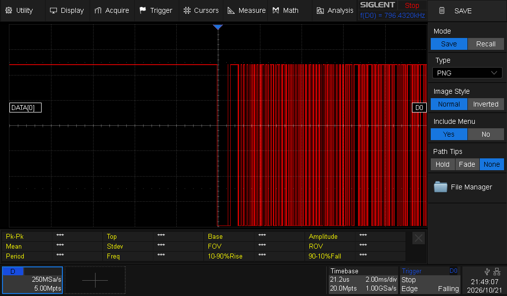

# Laboratoire 4 / Partie 1


## Partie 1:

- Communication avec One-Wire (Temperature sensor)

Pour One-Wire, il faut une librairie via l'arduino IDE: `OneWire` by **Jim Studt, Tom Pollard, Robin James...**

Pour cette section, le code utilisé sera dans les exemples: `Examples/OneWire/DS18s20`.


> $\color{gray}{\text{MANIPULATION}}$ **One-Wire**
>
> Avec l'exemple, changer la pin de signal pour la pin 4
>
> ```
> --- line 10: ds(10);
> +++ line 10: ds(4);
> ```
> 
> Vos futurs branchements seront sous forme d'annotation technique:
> ```
> // DQ -> 4
> // VCC -> 5V
> // GND -> GND
> // DQ with pull-up 4.7kOhm
> ```


> $\color{gray}{\text{MANIPULATION}}$ **One-Wire oscilloscope**
>
> Brancher l'oscilloscope via les sondes numériques et obtenir une trame sur DQ
>

La trame ressemble à ceci:



> $\color{darkred}{\text{À VÉRIFIER}}$ **One-Wire Eval**
>
> Montrer à l'enseignant la prise de data à l'oscilloscope
> (Pas besoin de la décoder)
> Montrer aussi votre moniteur, l'enseignant va vérifier la température
> 


> $\color{darkgreen}{\text{QUESTION}}$ **Question.docx**
> 
> Remplir les questions de la partie 1 et capturer l'oscilloscope
> 


