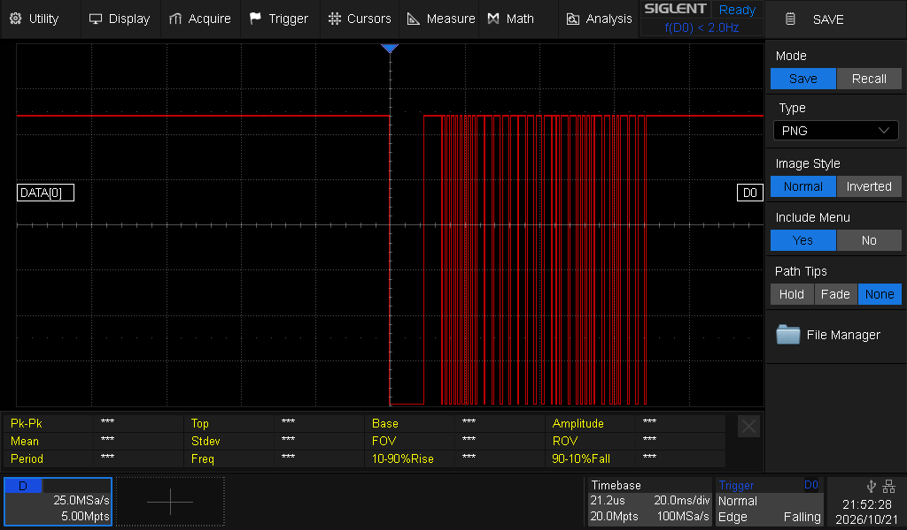

# Laboratoire 4 / Partie 2


## Partie 2:

- Communication avec infrarouge (Manette et senseur)


Pour l'infrarouge, il faut une librairie via l'arduino IDE: `IRremote` by **shirriff, z3t0, ArminJo**

Pour cette section, le code utilisé sera dans les exemples: `Examples/IRremote/TinyReceiver`.


> $\color{gray}{\text{MANIPULATION}}$ **Infra**
>
> L'exemple est utilisable sans changement
> 
> Branchement:
> ```
> // '-' -> GND
> // '+' -> 5V
> // S -> 2
> ```


> $\color{gray}{\text{MANIPULATION}}$ **Infra oscilloscope**
>
> Brancher l'oscilloscope via les sondes numériques et obtenir une trame sur S
>
> Montrer la réception de la commande `0` et `REPEAT`
>

La trame ressemble à ceci:



La commande `REPEAT` est possible en maintenant le bouton sur votre télécommande.

> $\color{darkred}{\text{À VÉRIFIER}}$ **One-Wire Eval**
>
> Montrer à l'enseignant la prise de data à l'oscilloscope
> (Pas besoin de la décoder)
> Montrer aussi votre moniteur, l'enseignant va vérifier le code hexadecimal
> 


> $\color{darkgreen}{\text{QUESTION}}$ **Question.docx**
> 
> Remplir les questions de la partie 2 et capturer l'oscilloscope
> 


