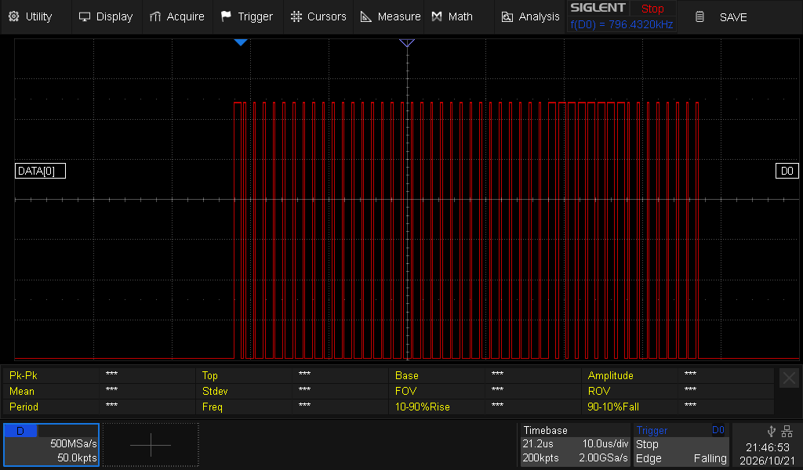

# Laboratoire 4 / Partie 3


## Partie 3:

- Communication avec DEL strip


Pour les DELs/LEDs, il faut une librairie via l'arduino IDE: `FastLED` by **Daniel Garcia**

Pour cette section, le code utilisé sera dans les exemples: `Examples/FastLED/Blink`.


> $\color{gray}{\text{MANIPULATION}}$ **DEL**
>
> L'exemple est utilisable avec des changements minimaux
> ```
> --- (Line 9): #define NUM_LEDS 1
> +++ (Line 9): #define NUM_LEDS 15
> 
> --- (line 79-83): leds[i] = CRGB::Red;
> +++ (line 79-83): leds[i].setRGB(255,0,0);
> ```
> 
> Branchement:
> ```
> // GND -> GND
> // V+ -> 5V
> // IN -> 3
> ```
> 
> Vérifier si l'ensemble des lumières illumiment par intermittence
> 

La méthode `setRGB(255,0,0);` équivaut à rouge, mais tester `setRGB(0,255,0);`(Vert) et `setRGB(0,0,255);` (Bleu)


> $\color{gray}{\text{MANIPULATION}}$ **DEL oscilloscope**
>
> Forcer 1 seul DEL à flasher (remettre `NUM_LEDS` à `1`)
> 
>  ```
> --- (Line 9): #define NUM_LEDS 15
> +++ (Line 9): #define NUM_LEDS 1
> ```
> 
> Brancher l'oscilloscope via les sondes numériques et obtenir une trame sur IN
>
> 

La trame ressemble à ceci: (Mais un peu plus petite)



Tester le code avec 1 ET 2 DELs/LEDs en Vert, Rouge et Bleu. 

> $\color{darkred}{\text{À VÉRIFIER}}$ **DEL Eval**
>
> Montrer à l'enseignant la prise de data à l'oscilloscope
> (Pas besoin de la décoder)
> Pour les 3 couleurs et avec 2 LEDs (`NUM_LEDS 2`)
> 


> $\color{darkgreen}{\text{QUESTION}}$ **Question.docx**
> 
> Remplir les questions de la partie 3 et capturer l'oscilloscope
> 


