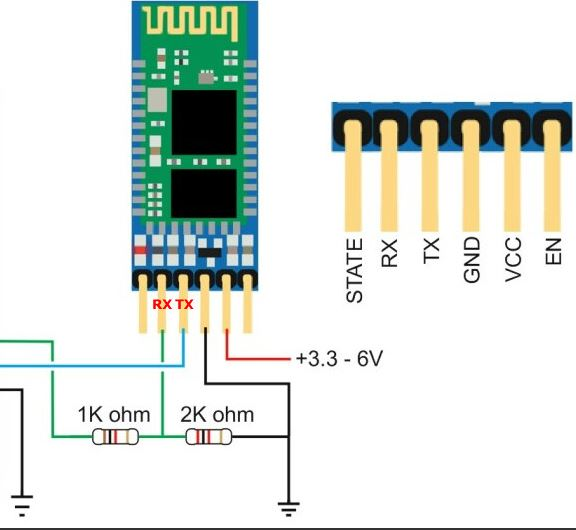

# Laboratoire 5 / Partie 1


## Partie 1:

- Communication avec module BLE

Pour la section Bluetooth, nous allons utiliser une librairie: `ArduinoBlue` by **Jae An**

Pour cette section, le code utilisé va dépendre de votre téléphone. S'il s'agit d'un Android:
```

#include <SoftwareSerial.h>

const unsigned long BAUD_RATE = 9600;

// The bluetooth tx and rx pins must be supported by software serial.
// Visit https://www.arduino.cc/en/Reference/SoftwareSerial for unsupported pins.
// Bluetooth TX -> Arduino D8
const int BLUETOOTH_TX = 7;
// Bluetooth RX -> Arduino D7
const int BLUETOOTH_RX = 8;

const int READ_TIME = 500;

SoftwareSerial bt(BLUETOOTH_TX, BLUETOOTH_RX);

void setup() {
	// Baud rate must be same for bluetooth and serial.
	// It helps to prevent interference.
	bt.begin(BAUD_RATE);
	Serial.begin(BAUD_RATE);
	Serial.println("Setup Complete");
}

void loop() {
	// while incoming signal is available.
	if (bt.available()) {
		unsigned long readStart = millis();
		while (bt.available() || millis() - readStart < READ_TIME) {
			if (bt.available()) {
				Serial.print((char)bt.read());
			}
		}
		Serial.println();
	}

	while (Serial.available()) {
		String input = Serial.readStringUntil('\r');
		String output = "";
		for (int i = 0; i < input.length(); i++) {
			char c = input.charAt(i);
			if (c != 10 && c != 13) { // Don't send line end characters to HM 10 
				output += c;
			}
		}
		Serial.print("Entered: "); Serial.println(output);
		bt.print(output);
	}
}

```

Sinon iOS:
```
#include <SoftwareSerial.h>

unsigned long BAUD_RATE = 9600;

// The bluetooth tx and rx pins must be supported by software serial.
// Visit https://www.arduino.cc/en/Reference/SoftwareSerial for unsupported pins.
// Bluetooth TX -> Arduino D8
const int BLUETOOTH_TX = 7;
// Bluetooth RX -> Arduino D7
const int BLUETOOTH_RX = 8;

const int READ_TIME = 500; //ms

unsigned long prevMillis;

SoftwareSerial bluetooth(BLUETOOTH_TX, BLUETOOTH_RX);

void setup() {
  // Start serial communications.
  // The baud rate must be the same for both the serial and the bluetooth.
  Serial.begin(BAUD_RATE);
  bluetooth.begin(BAUD_RATE);
  Serial.println("Setup Complete");
}

void loop() {
  // put your main code here, to run repeatedly:
  if (Serial.available()) {
    String str = "";
    Serial.print("Input: ");
    
    prevMillis = millis();
    while (millis() - prevMillis < READ_TIME) {
      if (Serial.available()) {
        char c = Serial.read();
        if (c != 10 && c != 13) { // Don't send line end characters to HM10.
          str += c;
        }
      }
    }
    
    bluetooth.print(str);
    Serial.println(str);
  }

  if (bluetooth.available()) {
    String str = "";
    Serial.print("HM10: ");
    
    prevMillis = millis();
    while (millis() - prevMillis < READ_TIME) {
      if (bluetooth.available()) {
        str += (char) bluetooth.read();
      }
    }
    Serial.println(str);
  }
}

```


Effectuer le branchement suivant: 



> $\color{gray}{\text{MANIPULATION}}$ **BLE**
>
> 
> Utiliser une tension de 5V pour l'alimentation. À l'aide de l'exemple et de la documentation. Connecter une paire TX et RX fonctionnel
> 

> $\color{gray}{\text{MANIPULATION}}$ **BLE Téléphone**
>
> 
> Aller dans le App Store et télécharger:
>
> - Android: `Serial Bluetooth Terminal`
> - iOS: `Arduino Bluetooth Control`
> 

Dans le but d'utiliser les applications. Votre matériel dois être 'PAIR' avec votre téléphone.

Voici la procédure de base. 

- Aller dans les paramètres Bluetooth. Le matériel sera HC-06 ou HC-05. Assurez-vous que ce soit le votre, alimenter le votre seulement quand vous être prêt à le connecter.
- Au moment du `pairing`, s'il y a un mot de passe demander, écrire: `1234`. C'est le mot de passe par défaut des appareils Bluetooth.
- Une fois `paired`. Utiliser l'application et connectez-vous au module. Une fois brancher, utiliser la fonction `READ` ou `WRITE` du service de base.
- **TRÈS IMPORTANT** Quand vous avez fini, utiliser la fonction `Unpair` dans vos paramètre Bluetooth. Cela va empecher de connecter à un module en tout temps de façon automatique.

> $\color{gray}{\text{MANIPULATION}}$ **Comm**
>
> 
> À l'aide de l'oscilloscope, valider l'envoi et la réception de data sur la pin Rx et Tx
> 


> $\color{darkred}{\text{À VÉRIFIER}}$ **Comm Eval**
>
> Montrer à l'enseignant la communication Bidirectionnel des données via l'application et l'oscilloscope
> 


> $\color{darkgreen}{\text{QUESTION}}$ **Question.docx**
> 
> Remplir les questions de la partie 1 et capturer l'oscilloscope
> 


